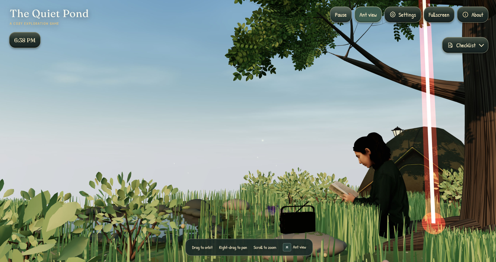

<p align="center">
  <picture>
    
  </picture>
</p>

<h1 align="center">The Quiet Pond</h1>

<p align="center">
  <em>A cozy ant exploration game in a procedural pond world.</em>
</p>

<p align="center">
  <a href="https://github.com/corvasto/the-quiet-pond"></a>
  <a href="https://github.com/corvasto/the-quiet-pond/commits/main"></a>
  <a href="https://github.com/corvasto/the-quiet-pond/actions/workflows/deploy-pages.yml"></a>
</p>

<p align="center">
  🌐 Play here: <a href="https://corvasto.github.io/the-quiet-pond/">https://corvasto.github.io/the-quiet-pond/</a>
</p>

---

<h2 align="center">Support</h1>
<p align="center">
  <em>If you or your kids enjoy playing around with this game, you can support its development here</em>
</p>

<p align="center">
  <a href="https://trakteer.id/corvasto_/tip"></a>
  <a href="https://ko-fi.com/corvasto"></a>
</p>

---

A cozy ant exploration game about a living pond. Find seeds, climb through the scenery, and discover its daily routines. A procedural pond with changing weather, a day/night cycle, radio music, English/Indonesian text, touch controls, three save slots, and offline play.

The Quiet Pond is a hobby project I'm making with my kids, with help from OpenAI Codex for coding and development. I also review and refine the code.

## Play from the source code

Serve the project folder over HTTP, then open `index.html` or the folder root. Modules, models, and audio do not work from `file://`.

## Install on a phone

Open the HTTPS site (example from this repo: https://corvasto.github.io/the-quiet-pond) while online:

- **Android with Chrome:** Open the three-dot menu and tap **Install app** or **Install and create shortcut**, then confirm.
- **iPhone with Safari:** Tap **Share > Add to Home Screen**. If offered, turn on **Open as Web App**, then tap **Add**.

Load the game once online and let it finish caching for offline play. Menus vary by browser. See Google's [Android install guide](https://support.google.com/chrome/answer/9658361?co=GENIE.Platform%3DAndroid&hl=en) and Apple's [iPhone Home Screen guide](https://support.apple.com/guide/iphone/bookmark-a-website-on-iphone-iph42ab2f3a7/ios).

## Controls

### Desktop

| Input | Action |
| --- | --- |
| WASD or arrow keys | Move relative to the view |
| Hold Shift | Run |
| Drag the scene | Look around |
| Wheel or pinch | Adjust camera distance |
| C | Reset the camera behind the ant |
| Space | Climb or get down |
| M | Toggle Explore |
| P or Escape | Pause or resume |
| F | Fullscreen |

### Mobile

- Drag the camera-relative joystick in any direction. Distance from the center controls speed, including on diagonals.
- Tap and hold **A** to run.
- Tap **B** to climb or get down.
- Drag the scene to orbit while moving, as with keyboard movement. The ant keeps its current travel heading while you swipe. Pinch to adjust camera distance.

See [controls](docs/controls.md) and [gameplay](docs/gameplay.md) for camera behavior, traversal, and objectives.

## Explore the pond

Gather seeds, deliver a leaf offering, and discover the pond's hidden details. Progress saves locally; saves and language preferences are tied to the site's origin. See [gameplay](docs/gameplay.md).

## Project structure

```text
index.html          Game page
js/
  main.js           Startup, interface, browser input, and saves
  config/           Application, world, rendering, and gameplay settings
  content/          Models, localized messages, and objective definitions
  core/             PondApp, rendering, actors, camera, and world queries
  game/             Session, objectives, seeds, climbing, and audio
  generators/       Procedural terrain, vegetation, rocks, and water
  props/            Model loading, animation, placement, and collision proxies
  ui/               Text presentation helpers
  utils/            Shared math, timing, noise, and motion helpers
styles/             Game interface styles
assets/             Models, audio, and other game assets
vendor/             Local Three.js runtime and license
scripts/            Project validation and headless tests
docs/               Architecture, tuning, content, and verification guides
build/release/      Generated minified production site (not committed)
```

## Configuration and architecture

Settings and quality profiles live in `js/config/`. Add `?q=full`, `?q=mid`, or `?q=low` to the URL to choose the browser startup profile. You can also change quality in the in-game Settings menu (Auto, Low, Mid, Full), alongside language, chimes, FPS diagnostics, and About. Auto selects Mid on mobile and Full elsewhere. All profiles use High Quality world generation; Full is uncapped, while Mid and Low target about 20 FPS. Applying settings and reloading saves progress. See [configuration](docs/configuration.md), [architecture](docs/architecture.md), [content framework](docs/content-framework.md), and [scene customization](docs/scene-customization.md).

Debug tools require `?debug=1`. Combine it with a startup profile, such as `?q=mid&debug=1`.

## Development and verification

Run `npm run check` for syntax, imports, assets, localization, quality settings, release metadata, and cache coverage. Run `npm test` for movement and offline-shell tests. Run `npm run build:release` to generate the minified, compressed site in `build/release`. These commands do not start a server.

Rendering, touch, collisions, performance, installation, and offline use need browser/device checks. See the [verification checklist](docs/verification.md) and [offline guide](docs/pwa.md).

## Credits

About has expandable model credits. [THIRD_PARTY_NOTICES.md](THIRD_PARTY_NOTICES.md) lists asset sources and terms; [LICENSE](LICENSE) covers original project software only. Third-party assets retain their own licenses. Three.js has its own license in `vendor/three/LICENSE`.
